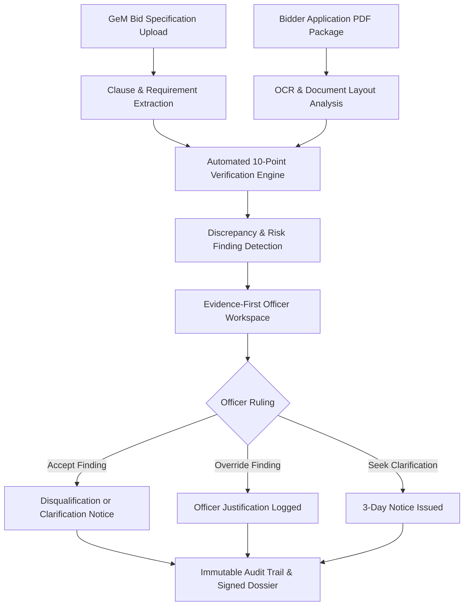

# BidGuard AI

> **AI-Assisted Procurement Verification & Decision-Support Platform**  
> *Designed for Government e-Marketplace (GeM) & Public Sector Procurement Standards*

---

> [!IMPORTANT]
> **STATUTORY NON-AUTONOMOUS NOTICE**  
> **BidGuard AI is a non-autonomous procurement decision-support system. It provides evidence, verification results, compliance analysis, and advisory findings. Final procurement decisions remain strictly with the designated Procurement Officer.**

---

## Table of Contents
1. [Overview & Problem Solved](#1-overview--problem-solved)
2. [Core Workflow](#2-core-workflow)
3. [System Architecture](#3-system-architecture)
4. [Key Features](#4-key-features)
5. [Tender & Bidder Application Workflow](#5-tender--bidder-application-workflow)
6. [Document Verification & Evidence Viewer](#6-document-verification--evidence-viewer)
7. [Compliance Matrix](#7-compliance-matrix)
8. [Risk & Findings Center](#8-risk--findings-center)
9. [Multi-Bidder Comparison](#9-multi-bidder-comparison)
10. [AI Procurement Assistant](#10-ai-procurement-assistant)
11. [Reports & Executive Compliance Dossier](#11-reports--executive-compliance-dossier)
12. [Immutable Audit Trail](#12-immutable-audit-trail)
13. [Officer Safeguards](#13-officer-safeguards)
14. [Demo Data & Synthetic Records](#14-demo-data--synthetic-records)
15. [Verification Capabilities & Boundaries](#15-verification-capabilities--boundaries)
16. [Local Setup Guide](#16-local-setup-guide)
17. [Testing & Quality Verification](#17-testing--quality-verification)

---

## 1. Overview & Problem Solved

### What BidGuard AI Does
BidGuard AI assists public procurement evaluation committees and tender scrutiny officers by cross-verifying bidder-submitted application documents against published GeM bid specifications. It surfaces cross-document discrepancies, extracts clause-by-clause evidence, and generates audit-ready compliance dossiers.

### Problem Being Solved
Public procurement scrutiny faces systemic operational bottlenecks:
- **Massive Document Volume**: Complex tenders require hundreds of pages of affidavits, CA certificates, audited balance sheets, work orders, and bank guarantees.
- **Cross-Document Inconsistencies**: Figures in CA turnover certificates often contradict audited profit & loss statements; completion certificates may fail to match claimed contract values.
- **Omission Risks**: Mandatory statutory affidavits (e.g., non-blacklisting, VVIP security clearance) are easily overlooked in multi-file bundles.
- **Cognitive Fatigue**: Verification officers must manually cross-reference clauses against multiple PDF pages, risking human oversight.

BidGuard AI solves this by functioning as an evidence-grounded copilot that extracts text, checks requirements, and places the original submitted document page beside each finding.

---

## 2. Core Workflow



---

## 3. System Architecture

- **Frontend**:
  - React 18, TypeScript, Vite SPA.
  - Vanilla CSS design system with GeM Executive White theme tokens.
  - Collapsible 72px rail sidebar navigation.
  - Integrated evidence viewer with native PDF rendering, page jumping, zoom controls, and split-screen comparison.
- **Backend**:
  - Python 3.10+, FastAPI async REST API.
  - Pydantic v2 schemas and models.
  - Deterministic Intent Engine & Vector Semantic Retrieval hybrid.
  - Resilient local offline fallback logic (zero external LLM lock-in).
  - SQLAlchemy async models with PostgreSQL / asyncpg support.

---

## 4. Key Features

- **Collapsible Executive Navigation**: 10 primary views with 72px collapsed icon rail and tooltips.
- **Single-Bidder vs Multi-Finding Canonical Consistency**: Accurately tracks 1 bidder application containing 6 documents and 5 findings without duplicating bidders.
- **Multi-Bidder Comparison Matrix**: Tabular cross-bidder evaluation comparing turnover, experience, EMD, and compliance scores.
- **Evidence-First Document Viewer**: Embeds the original applicant-submitted PDF with highlighted jump-pills and page navigation.
- **Procurement Intent Chatbot**: Answers natural-language procurement questions regarding clauses, documents, findings, and pending actions with clause citations.
- **Officer Safeguard Disclaimers**: Persistent statutory disclaimers ensuring no automated disqualification or vendor selection occurs.

---

## 5. Tender & Bidder Application Workflow

1. **Tender Selection & Catalog**:
   - Canonical Tender: `GEM/2021/B/1128240` (Manpower Services for CAG of India, New Delhi; Estimated: ₹7.14 Cr).
   - Ability to upload new GeM tenders with automated requirement extraction.
2. **Bidder Application Package (APP-001)**:
   - Bidder: `Aravind Integrated Solutions Private Limited`.
   - 6 submitted documents (16 extracted pages).
   - Document inventory:
     1. `01_Bid_Submission_and_Technical_Bid_Form.pdf` (3 pages)
     2. `02_Company_Incorporation_and_Statutory_Registrations.pdf` (3 pages)
     3. `03_Financial_Turnover_and_Audited_Statements.pdf` (4 pages)
     4. `04_Past_Experience_Work_Orders_and_Completion.pdf` (3 pages)
     5. `05_Statutory_Affidavits_and_Compliance_Undertakings.pdf` (2 pages)
     6. `06_EMD_Bank_Guarantee_State_Bank_of_India.pdf` (1 page)

---

## 6. Document Verification & Evidence Viewer

BidGuard conducts 10 standardized procurement checks across submitted files:
1. **Company Legal Existence & RoC Registration** — [Compliant]
2. **Delhi NCR Registered/Operational Office** — [Compliant]
3. **Earnest Money Deposit (EMD) Guarantee** — [Compliant]
4. **Three-Year Average Financial Turnover** — [Partial / Discrepancy]
5. **Past Manpower Project Experience** — [Partial / Missing Completion]
6. **Statutory Labour Registrations (EPF/ESIC/Labour)** — [Compliant]
7. **PAN & GSTIN Active Registration** — [Compliant]
8. **Statutory Non-Blacklisting Undertakings** — [Compliant]
9. **Annexure-9 VVIP Security Area Non-Criminal Affidavit** — [Evidence Missing]
10. **Office Staff Typing & Proficiency Undertaking** — [Clarification Pending]

---

## 7. Compliance Matrix

Interactive clause-by-clause matrix comparing tender specifications to applicant responses:
- Filters by status (Compliant, Non-compliant, Partial, Evidence Missing, Clarification Pending).
- Displays exact clause text, requirement parameter, applicant evidence excerpt, and confidence score.
- Detail drawer with source document filename and page citation.

---

## 8. Risk & Findings Center

The Risk & Findings Center provides a 3-column split-screen review workspace:
- **Left Column**: List of 5 findings for APP-001 with severity tags (Critical, High, Medium, Low).
- **Middle Column**: The original PDF document displayed with zoom (50% to 200%), page navigation, and full-screen preview.
- **Right Column**: Detailed finding analysis, cross-document comparison, auditor notes, and the **Officer Ruling Action Dialog** (Accept Finding, Override with Justification, Request 3-Day Clarification).

### The 5 Findings for APP-001:
- **FND-01 [CRITICAL]**: Omission of Mandatory Annexure-9 VVIP Security Clearance Affidavit.
- **FND-02 [HIGH]**: ₹80.15 Lakhs Cross-Document Turnover Discrepancy (CA Certificate vs Audited P&L for FY 2019-20).
- **FND-03 [MEDIUM]**: Missing Final Completion Certificate for SAIL Bokaro Project.
- **FND-04 [LOW]**: Typist Speed Certificate Not Stipulated in Technical Form.
- **FND-05 [INFO]**: Minor Trade Name Stylistic Variation in EPF Code (Aravind Solutions vs Aravind Integrated Solutions).

---

## 9. Multi-Bidder Comparison

Enables evaluation committees to benchmark bidders:
- Canonical demo includes `APP-001` (Aravind Integrated Solutions) with 10 checks and 5 findings.
- Comparative analytics for Turnover, EMD, Compliant Ratio, and Pending Findings.
- Dynamic readiness for `APP-002` and additional competitor submissions.

---

## 10. AI Procurement Assistant

A grounded, non-hallucinating procurement chatbot capable of understanding procurement terminology and shorthand queries:
- **Tender Queries**: *"What is this tender?"*, *"What is the EMD?"*, *"emd?"*
- **Bidder Queries**: *"Who is the bidder?"*, *"bidder?"*, *"How many documents were submitted?"*, *"what docs?"*
- **Findings & Deficiencies**: *"What is pending?"*, *"What is missing?"*, *"Why was the turnover flagged?"*
- **Statutory Limits**: *"Can GST be verified?"* -> Explains live portal boundary; reviews submitted evidence.
- **Officer Support**: *"What requires officer review?"*, *"What can you do?"*

---

## 11. Reports & Executive Compliance Dossier

Generates comprehensive, exportable evaluation dossiers:
- Executive Summary of tender and bidder identity.
- 10-point verification checklist breakdown.
- Finding details with officer ruling statuses and audit timestamps.
- Ready for printing or export to committee procurement archives.

---

## 12. Immutable Audit Trail

Every action taken within the platform is recorded with:
- Timestamp (ISO 8601).
- Actor ID & Role (`Procurement Officer`, `System`, `AI Engine`).
- Event Type (`FINDING_RULED`, `DOCUMENT_VIEWED`, `DOSSIER_GENERATED`, `CLARIFICATION_ISSUED`).
- Contextual metadata and cryptographic hash.

---

## 13. Officer Safeguards

BidGuard AI enforces non-autonomous design principles:
- **No Automated Winners**: The system explicitly refuses to recommend winning bidders or rank bids for contract award.
- **Mandatory Human Ruling**: High and Critical findings require human review and cannot be auto-dismissed.
- **Transparent Evidence Grounds**: Every finding links to an exact PDF filename and page number.

---

## 14. Demo Data & Synthetic Records

> [!CAUTION]
> **DEMO / SYNTHETIC DATA NOTICE**  
> All applicant identities, corporate names (`Aravind Integrated Solutions Private Limited`), registration numbers (CIN `U74999DL2016PTC301429`, GSTIN `07AAACA9182K1Z5`, PAN `AAACA9182K`, EPF, ESIC, Labour licenses), bank guarantees, and CA certificates are **synthetic records created exclusively for testing and demonstration purposes**.  
> They do **NOT** represent real individuals, private corporations, or authentic government portal queries.

---

## 15. Verification Capabilities & Boundaries

### What Can Be Verified:
- Document completeness against mandatory tender annexures.
- Arithmetic consistency across balance sheets, CA certificates, and bid declarations.
- Threshold qualification (minimum turnover ₹357.36L, EMD ₹35.73L, past contract value).
- Date validity (registration dates, validity period of bank guarantees).

### What Cannot Be Verified (Without Live Connectors):
- Direct external MCA21 company master lookup.
- Live GSTN tax return filing status (GSTR-3B / GSTR-1).
- Live EPFO / ESIC contribution receipt verification.
- Real-time SFMS bank guarantee confirmation from State Bank of India.
*(The platform flags these as `NOT_CONFIGURED / UNSUPPORTED_LOOKUP` and prompts for manual officer verification).*

---

## 16. Local Setup Guide

### Prerequisites
- Node.js 18+ & npm
- Python 3.10+
- Git

### Backend Setup
```bash
cd backend
python -m venv .venv
.\.venv\Scripts\activate  # Windows (or source .venv/bin/activate on Linux/macOS)
pip install -r requirements.txt
python -m uvicorn app.main:app --host 0.0.0.0 --port 8000
```

### Frontend Setup
```bash
cd frontend
npm install
npm run dev -- --host 0.0.0.0
```
Visit **http://localhost:5173** in your browser.

---

## 17. Testing & Quality Verification

### Run Backend Tests (180 Tests)
```bash
cd backend
.\.venv\Scripts\pytest tests/ -q
```
*Result: 180 passed (100% green).*

### Run Frontend Production Build & Linting
```bash
cd frontend
npm run build
npm run lint
```
*Result: 0 build errors, 0 lint errors.*

---

## License & Copyright
Developed for public procurement transparency, evidence verification, and AI-assisted governance evaluation.
